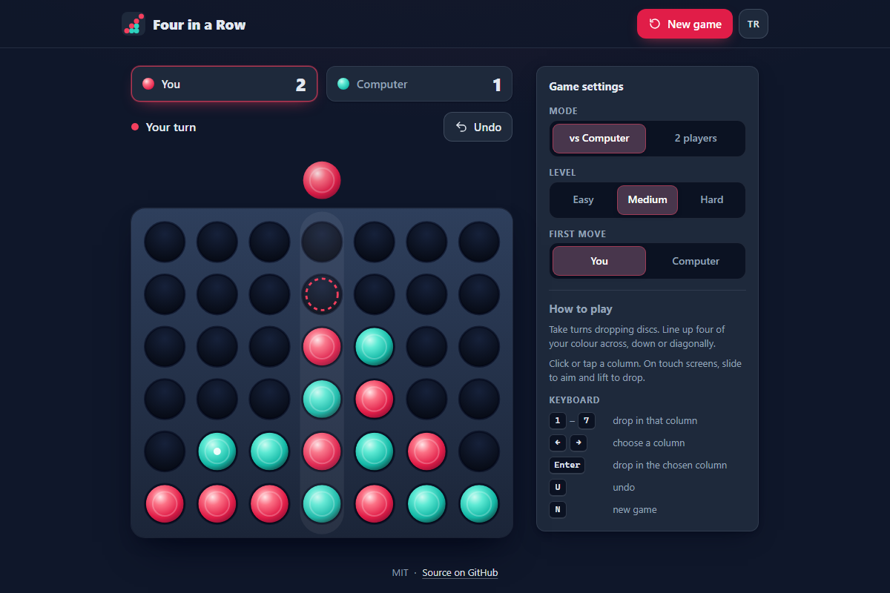

# Four in a Row - drop discs, line up four and outsmart a computer player, right in your browser

[](#tests)
[](LICENSE)

**▶ Play now: https://celaldrg.github.io/four-in-a-row/**



## Features

- Play the computer on three levels (easy, medium, hard) or a friend on the same device.
- Choose who moves first against the computer; between two players the first move alternates.
- The computer uses negamax with alpha-beta pruning, a transposition table and iterative
  deepening. It runs in a Web Worker, so the page never freezes while it thinks.
- Discs fall with a small bounce, the column under the cursor shows where the disc will land,
  and the winning line pulses.
- Undo (against the computer it takes back your move and its reply), a score for each side
  and a new game at any time.
- Mouse, touch and keyboard controls; moves are announced to screen readers.
- English and Turkish; your language and settings are remembered in this browser.
- Respects "reduce motion" and fits phones from 320 px wide.
- No dependencies, no build step, no tracking: plain HTML, CSS and JavaScript modules.

## How to play

Take turns dropping discs into the seven columns; each disc falls to the lowest free hole.
The first player to line up four discs across, down or diagonally wins. A full board is a draw.

| Action          | Keyboard                                     | Mouse / touch                                                   |
| --------------- | -------------------------------------------- | --------------------------------------------------------------- |
| Drop a disc     | <kbd>1</kbd>–<kbd>7</kbd>                    | Click or tap a column                                           |
| Aim and drop    | <kbd>←</kbd> <kbd>→</kbd>, then <kbd>Enter</kbd>, <kbd>Space</kbd> or <kbd>↓</kbd> | Touch: slide along the board to aim, lift your finger to drop |
| Undo            | <kbd>U</kbd>                                 | **Undo** button                                                 |
| New game        | <kbd>N</kbd>                                 | **New game** button                                             |
| Language        |                                              | **TR** / **EN** button                                          |

Mode, level and who starts are in the settings panel (on phones: tap the settings bar under the
board). Add `?demo` to the address to open a fixed mid-game position; the screenshot above uses it.

## Run locally

```sh
npx serve .
```

Then open the address it prints. ES modules and the Web Worker need `http://`; opening
`index.html` straight from disk (`file://`) does not work. Any static file server will do.

## Tests

```sh
node --test
```

No packages to install; the tests use Node's built-in test runner (CI runs Node 22) and finish
in a few seconds. The key check: the computer, searching at a fixed depth of 6, plays 200 seeded
games against a random mover (100 moving first, 100 moving second) and must not lose a single
one. The other tests cover win detection in all four directions (edges and corners included),
full columns, draws, turns and undo, taking an immediate win and blocking an immediate loss,
agreement with a plain minimax search, settings, match rules, keyboard mapping, translations,
storage, the worker messages and the consistency of the page.

## Project structure

```text
index.html           page markup
style.css            dark theme, responsive layout, animations
src/
  board.js           board model, drops, win and draw detection
  game.js            turns, history, undo, the ?demo position
  position.js        incremental position for the search (threat windows, Zobrist hash)
  ai.js              negamax with alpha-beta, transposition table, iterative deepening
  rng.js             seeded random numbers
  settings.js        game options and their validation
  match.js           who starts, what Undo takes back, score, status line
  keyboard.js        keys to game actions
  i18n.js            English and Turkish texts
  storage.js         localStorage that never throws
  ai-worker.js       Web Worker that runs ai.js
  ai-client.js       promise-based messages to the worker
  board-view.js      SVG board, drop animation, pointer input
  main.js            page controller
test/                node:test suites
docs/screenshot.png  README screenshot (index.html?demo)
```

Everything except `storage.js`, `ai-worker.js`, `ai-client.js`, `board-view.js` and `main.js`
is pure logic without the DOM, so it is tested directly in Node.

## License

[MIT](LICENSE) © 2026 Celalettin Durgaç

## Türkçe

**▶ Hemen oyna: https://celaldrg.github.io/four-in-a-row/**

Taşları sütunlara bırak, dördünü yan yana getir: bilgisayara ya da bir arkadaşına karşı,
doğrudan tarayıcında.

### Özellikler

- Üç seviyeli bilgisayar rakip (kolay, orta, zor) ya da aynı cihazda iki oyuncu.
- Bilgisayara karşı ilk hamleyi kimin yapacağını seç; iki oyunculu modda ilk hamle her oyunda
  sırayla değişir.
- Bilgisayar alfa-beta budamalı negamax, geçiş tablosu ve derinleştirerek arama kullanır. Bir
  Web Worker içinde çalıştığı için düşünürken sayfa donmaz.
- Taşlar küçük bir sekmeyle düşer, imlecin altındaki sütun taşın nereye ineceğini gösterir,
  kazanan dörtlü nabız gibi atar.
- Geri al (bilgisayara karşı senin hamleni ve cevabını birlikte geri alır), iki taraf için skor
  ve istediğin an yeni oyun.
- Fare, dokunmatik ve klavye kontrolü; hamleler ekran okuyuculara duyurulur.
- Türkçe ve İngilizce; dil ve ayarlar bu tarayıcıda hatırlanır.
- "Hareketi azalt" ayarına uyar, 320 px genişliğindeki telefonlara sığar.
- Bağımlılık, derleme adımı ve izleme yok: düz HTML, CSS ve JavaScript modülleri.

### Nasıl oynanır

Sırayla yedi sütundan birine taş bırakın; taş o sütundaki en alttaki boş deliğe düşer. Kendi
rengindeki dört taşı yatay, dikey ya da çapraz dizen ilk oyuncu kazanır. Tahta dolarsa oyun
berabere biter.

- **Taş bırak:** <kbd>1</kbd>–<kbd>7</kbd> tuşları ya da sütuna tıkla / dokun.
- **Nişan al ve bırak:** <kbd>←</kbd> <kbd>→</kbd> ile sütun seç, <kbd>Enter</kbd>,
  <kbd>Space</kbd> ya da <kbd>↓</kbd> ile bırak. Dokunmatik ekranda parmağını tahtada
  kaydırarak sütun seç, kaldırınca taş düşer.
- **Geri al:** <kbd>U</kbd> ya da **Geri al** düğmesi.
- **Yeni oyun:** <kbd>N</kbd> ya da **Yeni oyun** düğmesi.
- **Dil:** **TR** / **EN** düğmesi.

Mod, seviye ve ilk hamle ayarlar panelindedir (telefonda tahtanın altındaki ayar çubuğuna dokun).
Adrese `?demo` eklersen sabit bir oyun ortası pozisyonu açılır; yukarıdaki ekran görüntüsü
bununla alındı.

### Yerelde çalıştırma

```sh
npx serve .
```

Ardından yazdığı adresi aç. ES modülleri ve Web Worker `http://` ister; `index.html` dosyasını
doğrudan diskten (`file://`) açmak çalışmaz. Herhangi bir statik dosya sunucusu yeterlidir.

### Testler

```sh
node --test
```

Kurulacak paket yok; testler Node'un yerleşik test çalıştırıcısını kullanır (CI Node 22 ile
çalışır) ve birkaç saniyede biter. Ana kontrol: sabit 6 derinlikte arayan bilgisayar, rastgele
hamle yapan bir rakibe karşı sabit tohumlu (seed) 200 oyun oynar (100'ünde ilk, 100'ünde ikinci
başlar) ve hiçbirini kaybetmemelidir. Diğer testler dört yöndeki kazanma tespitini (kenarlar ve
köşeler dahil), dolu sütunları, beraberliği, sıra ve geri almayı, anında kazanmayı ve rakibin
kazanacağı hamleyi engellemeyi, düz minimax ile uyumu, ayarları, maç kurallarını, klavyeyi,
çevirileri, depolamayı, worker mesajlarını ve sayfanın tutarlılığını kapsar.

### Lisans

[MIT](LICENSE) © 2026 Celalettin Durgaç
